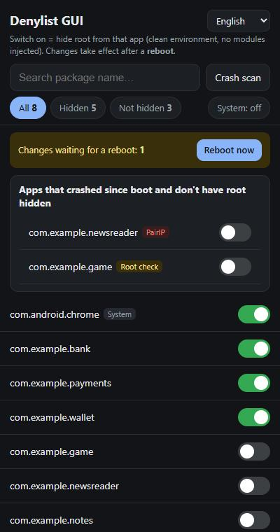

# APatch Denylist GUI

[中文](#中文) | [English](#english)

<p align="center"></p>

---

## 中文

一个 **APatch 模块 WebUI**,用图形界面管理 APatch 的 denylist(`/data/adb/ap/package_config` 中的 `exclude` 字段)。打开某个 App 的开关,就会对它**隐藏 Root**:在 Zygisk Next 的 denylist 强制模式下,该 App 启动时拿到干净环境,不注入任何 Zygisk 模块,模块挂载也会被还原。

适合「既要用 Root,又有银行、支付、带 Play 完整性保护的 App 一打开就闪退」的场景。

### 功能

- 列出所有第三方应用,每个 App 一个开关,打开即隐藏 Root
- **多语言界面**:简体中文、繁體中文、English、日本語、한국어、Русский、Español。首次打开按系统语言自动选择,右上角可随时切换,选择会被记住
- 按包名搜索,按「全部 / 已隐藏 / 未隐藏」筛选,可选显示系统应用(已隐藏 Root 的系统应用总是显示)
- **扫描崩溃**:读取本次开机以来的 crash 日志,列出崩溃过、但还没隐藏 Root 的 App,并标注原因:
  - `PairIP`:崩溃发生在 `libpairipcore.so`,即 Google Play 的 PairIP 防篡改检测到注入环境
  - `防Root`:抛出 `TerminateException`,App 自己检测到 Root 后主动退出
  - `崩溃`:其他原因
- 改动后提示待重启项,可一键重启
- 每次开机后首次修改前,自动备份 `package_config`(保留最近 10 份)

### 安全设计

- **只改 `exclude` 字段**,不碰 `allow`(su 授权)、uid 和 SELinux 上下文字段。你给其他 App 授予的 Root 权限不受影响
- 写回文件时覆盖原内容,不替换文件本身,所以文件权限和 SELinux 标签保持不变
- 包名先做白名单校验(`[A-Za-z0-9._]`),再拼进 shell 命令,防止命令注入

### 环境要求

| 项目 | 要求 |
|---|---|
| Root 方案 | APatch(读写 `/data/adb/ap/package_config`) |
| Zygisk | Zygisk Next,并开启 denylist 强制模式(`/data/adb/zygisksu/denylist_enforce` 为 `1`) |
| WebUI | APatch 管理器自带的模块 WebUI;不支持时可用 WebUI X / KsuWebUI 打开 |

> 本模块只负责**编辑名单**,真正的隐藏效果来自 Zygisk Next 的 denylist 强制模式。

### 安装

1. 从 [Releases](../../releases) 下载 zip,或按下文自行构建
2. APatch → 模块 → 从存储安装,选择该 zip
3. 重启后在 模块 → **Denylist GUI** → **打开** 进入界面

### 使用

1. 打开目标 App 的开关(变绿即已加入 denylist)
2. 遇到新的闪退 App:先打开它让它崩一次,再点「扫描崩溃」,把列出的 App 打开开关
3. 点顶部「立即重启」。**改动需要重启才生效**,因为 Zygisk Next 在开机时读取名单

### 新增或修改翻译

所有界面文字都在 `module/webroot/index.html` 顶部的 `I18N` 对象里:

1. 复制 `"en"` 整块,键名改成语言代码(如 `"de"`、`"pt-BR"`),`_name` 写该语言的自称(如 `Deutsch`)
2. 翻译各个值;`{n}`、`{p}`、`{e}` 是占位符,要原样保留。`sub`、`pending`、`noBridge` 里只允许 `<b>` 和 `<br>`
3. 缺失的键会自动回退到英文,所以可以先翻译一部分

欢迎提交 PR 补充语言或改进翻译。

### 命令行

界面背后是 `denyctl.sh`,也可以在 root shell 里直接用:

```sh
D=/data/adb/modules/denylist_gui/denyctl.sh
sh $D list             # 输出 包名|是否隐藏(0/1)|类型(u=第三方 s=系统)
sh $D add com.example  # 加入 denylist(exclude=1)
sh $D del com.example  # 移出 denylist(exclude=0,保留该行其余字段)
sh $D scan             # 本次开机以来崩溃过的 App:包名|pairip/rootcheck/other
```

从备份恢复:

```sh
ls -t /data/adb/denylist_gui_bak/
cat /data/adb/denylist_gui_bak/package_config.<时间戳> > /data/adb/ap/package_config
```

### 构建

```sh
python build.py   # 生成 dist/denylist_gui-<版本>.zip
```

`build.py` 统一把 zip 内路径写成正斜杠,并把文本文件转成 LF 换行,在 Windows 上打包也能在 Android 上正常安装。

### 项目结构

```
module/                    模块本体(打进 zip 的内容)
├── module.prop            模块信息
├── customize.sh           安装时设置权限
├── denyctl.sh             后端:list / add / del / scan
├── webroot/index.html     WebUI 界面
└── META-INF/...           标准模块安装器
build.py                   打包脚本
docs/screenshot.jpg        截图
```

### 已知限制

- 少数特殊包(如私密空间、TrichromeLibrary 这类静态共享库)不在 `pm list packages` 输出中,界面里看不到。它们在名单里的条目照样生效
- **denylist 解决不了所有闪退**:如果 App 在解析密钥认证证书链时崩溃(例如为了 STRONG 完整性而全局伪造了 keystore 认证),问题出在 keystore 层,与是否注入无关,加入 denylist 也没用
- 模块 id 固定为 `denylist_gui`,因为 WebUI 通过 `/data/adb/modules/denylist_gui/denyctl.sh` 这个路径调用后端

### 免责声明

修改 Root 隐藏配置可能导致应用行为异常。使用前请自行备份;因使用本项目造成的任何后果由使用者自行承担。

---

## English

An **APatch module with a WebUI** for managing APatch's denylist (the `exclude` field in `/data/adb/ap/package_config`). Turn an app's switch on to **hide root** from it: with Zygisk Next's enforced denylist, the app starts in a clean environment, with no Zygisk modules injected and module mounts reverted.

It is meant for setups where you want root, but banking, payment or Play-integrity-protected apps crash on launch.

### Features

- Lists all user apps, one switch per app; on means root is hidden from that app
- **Multilingual UI**: 简体中文, 繁體中文, English, 日本語, 한국어, Русский, Español. Picks your system language on first launch; switch any time from the menu in the top-right corner, and your choice is remembered
- Search by package name, filter by All / Hidden / Not hidden, optionally show system apps (system apps that already have root hidden are always shown)
- **Crash scan**: reads the crash log since boot and lists apps that crashed but don't have root hidden yet, tagged by cause:
  - `PairIP`: the crash is in `libpairipcore.so`, meaning Google Play's PairIP anti-tamper detected the injected environment
  - `Root check`: a `TerminateException`, where the app detected root and quit on purpose
  - `Crash`: any other cause
- Shows how many changes are waiting for a reboot, with a one-tap reboot button
- Backs up `package_config` before the first change after each boot (keeps the last 10)

### Safety

- **Only the `exclude` field is changed.** The `allow` (su grant), uid and SELinux context fields stay as they are, so root grants for your other apps are untouched
- The file is overwritten in place rather than replaced, so its permissions and SELinux label stay the same
- Package names are checked against an allow-list (`[A-Za-z0-9._]`) before they go into a shell command, which prevents command injection

### Requirements

| Item | Requirement |
|---|---|
| Root | APatch (reads and writes `/data/adb/ap/package_config`) |
| Zygisk | Zygisk Next with the enforced denylist on (`/data/adb/zygisksu/denylist_enforce` set to `1`) |
| WebUI | The module WebUI in the APatch manager; if yours lacks it, open the module with WebUI X or KsuWebUI |

> This module only **edits the list**. The hiding itself is done by Zygisk Next's enforced denylist.

### Install

1. Download the zip from [Releases](../../releases), or build it yourself (see below)
2. APatch → Modules → Install from storage, then pick the zip
3. Reboot, then open Modules → **Denylist GUI** → **Open**

### Usage

1. Turn on the switch for the target app (green means it is on the denylist)
2. For a newly crashing app: launch it once so it crashes, tap **Crash scan**, then turn on the switches for the apps it lists
3. Tap **Reboot now**. **Changes need a reboot** because Zygisk Next reads the list at boot

### Adding or editing a translation

All UI text lives in the `I18N` object at the top of `module/webroot/index.html`:

1. Copy the whole `"en"` block, rename the key to the language code (such as `"de"` or `"pt-BR"`), and set `_name` to the language's own name (such as `Deutsch`)
2. Translate the values. Keep the `{n}`, `{p}` and `{e}` placeholders as they are. `sub`, `pending` and `noBridge` may contain only `<b>` and `<br>`
3. Missing keys fall back to English, so a partial translation works

Pull requests adding languages or improving translations are welcome.

### Command line

The UI runs `denyctl.sh`, which you can also call from a root shell:

```sh
D=/data/adb/modules/denylist_gui/denyctl.sh
sh $D list             # package|hidden(0/1)|kind(u=user s=system)
sh $D add com.example  # add to denylist (exclude=1)
sh $D del com.example  # remove from denylist (exclude=0, other fields kept)
sh $D scan             # apps that crashed since boot: package|pairip/rootcheck/other
```

Restore a backup:

```sh
ls -t /data/adb/denylist_gui_bak/
cat /data/adb/denylist_gui_bak/package_config.<timestamp> > /data/adb/ap/package_config
```

### Build

```sh
python build.py   # writes dist/denylist_gui-<version>.zip
```

`build.py` writes forward-slash paths into the zip and converts text files to LF line endings, so a zip built on Windows still installs correctly on Android.

### Layout

```
module/                    the module itself (what goes into the zip)
├── module.prop            module metadata
├── customize.sh           sets permissions on install
├── denyctl.sh             backend: list / add / del / scan
├── webroot/index.html     WebUI
└── META-INF/...           standard module installer
build.py                   packaging script
docs/screenshot.jpg        screenshot
```

### Known limitations

- A few special packages (such as Private Space or static shared libraries like TrichromeLibrary) don't appear in `pm list packages`, so the UI can't show them. Their entries in the list still take effect
- **The denylist doesn't fix every crash.** If an app crashes while parsing its key attestation certificate chain (for example, because keystore attestation is spoofed globally to reach STRONG integrity), the problem is in the keystore layer, not injection, and adding the app to the denylist won't help
- The module id is fixed as `denylist_gui`, because the WebUI calls the backend at `/data/adb/modules/denylist_gui/denyctl.sh`

### Disclaimer

Changing root-hiding settings can make apps misbehave. Back up first; you use this project at your own risk.

---

## License

[MIT](LICENSE)
